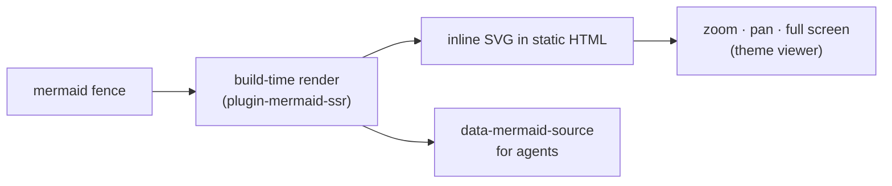
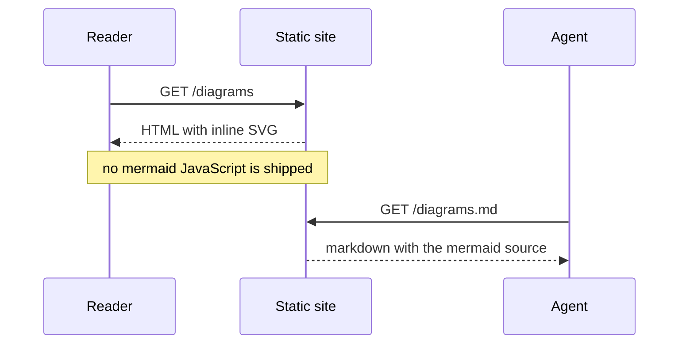
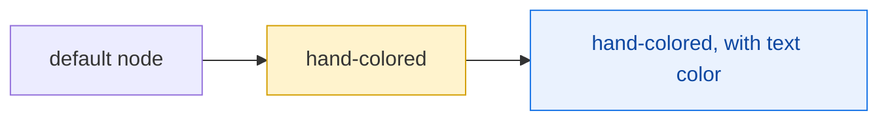
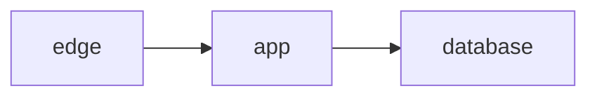

import Tabs from '@theme/Tabs';
import TabItem from '@theme/TabItem';

# Diagrams

Write a `mermaid` fence and PokeDocs does the rest. The diagram is rendered to
inline SVG **at build time**, the source is kept on the page for agents, it is
colored from your brand in light and dark mode, and readers get a viewer for
the diagrams that are too big to read in a column.



## The viewer

Every diagram gets an **Expand** button. Clicking it, or the diagram itself,
opens the diagram in a viewer that covers the window. Try it on the diagram
above.

| Action | Mouse or touch | Keyboard |
|---|---|---|
| Zoom | Scroll, pinch, or double-click | `+` and `-` |
| Pan | Drag | Arrow keys |
| Fit to screen | **Fit** | `0` |
| Actual size | The percentage | `1` |
| Full screen | The full-screen button | `F` |
| Close | The close button | `Esc` |

There is nothing to configure and nothing to swizzle. A few properties worth
knowing:

- **It stays sharp.** The SVG is resized rather than scaled as a bitmap, so
  labels are crisp at every zoom level, up to 800%.
- **It costs nothing elsewhere.** The pan and zoom code is its own chunk,
  fetched only on pages that contain a diagram.
- **It works without JavaScript.** The diagram is static HTML either way; the
  viewer is an enhancement on top of it.
- **Agents are unaffected.** The `pokedocs-mermaid` wrapper and its
  `data-mermaid-source` attribute are unchanged, and so are the `.md` twins.

## Colors

Mermaid bakes one palette into the SVG when it renders, which is why a
build-time diagram normally looks the same in light and dark mode, with dark
arrows disappearing into a dark page. PokeDocs recolors the baked SVG in CSS
instead, from the same variables your [branding](./branding.md) block compiles:

- Nodes take a tint of your brand color, with the brand color as the outline.
- Lines, arrowheads and text use the neutral scale, which flips with the color
  mode, so they stay readable on either background.

Switch the color mode with the toggle in the navbar and watch this one follow:



### Overriding a color

Set any color per mode with `mermaid.palette`. Unset colors keep the
brand-derived default.

```ts title="docusaurus.config.ts"
presets: [
  [
    '@pokedocs/preset',
    {
      mermaid: {
        palette: {
          light: { noteFill: '#fff8c5' },
          dark: { noteFill: '#3d3814', noteText: '#f3eec6' },
        },
      },
    },
  ],
],
```

| Key | What it colors |
|---|---|
| `text` | Labels and message text |
| `line` | Edges, message lines and arrowheads |
| `nodeFill`, `nodeStroke` | Flowchart nodes, sequence participants |
| `clusterFill`, `clusterStroke` | Subgraphs |
| `labelBackground` | The backing behind an edge label |
| `noteFill`, `noteStroke`, `noteText` | Sequence notes |

Each key is also a CSS variable (`nodeFill` is `--pokedocs-mermaid-node-fill`),
so `custom.css` works too. A misspelled key or a value that is not a color
fails the build with the key named.

### Colors you set in the diagram

A node you color by hand with `classDef` or `style` keeps that color in both
modes; the palette never overrides it. Hand-picked fills are usually light, so
in dark mode the label on such a node goes back to dark text unless you set a
`color` yourself.



### Keeping mermaid's own palette

`palette: false` leaves the baked colors alone. Setting mermaid's own
`themeVariables` or `mermaidConfig` does the same, since those bake the colors
you asked for into the SVG; add a `palette` next to them if you want both.

## Diagrams in tabs

A diagram inside a tab that starts hidden is a classic failure for
client-rendered mermaid: it measures a zero-sized container and draws nothing.
Build-time rendering has no such step, so tabs just work.

<Tabs>
  <TabItem value="text" label="Description" default>

  A request passes through the edge, then the app, then the database.

  </TabItem>
  <TabItem value="diagram" label="Diagram">



  </TabItem>
</Tabs>

## Customizing the frame

The frame around a diagram is a normal theme component,
`@theme/PokedocsMermaid`. Wrap it to change the button or the layout:

```bash
npx docusaurus swizzle pokedocs-theme-components PokedocsMermaid --wrap
```

## Turning it off

`mermaid: false` in the preset options turns off build-time rendering, the
palette and the viewer together. To keep the rendering and drop the viewer,
swizzle `@theme/PokedocsMermaid` and return a plain `<div {...props} />`.

## Using the packages without the preset

The preset registers all of this for you. If you wire the packages by hand,
add the theme after the classic theme:

```ts title="docusaurus.config.ts"
import { pokedocsThemeComponents } from '@pokedocs/theme';

export default {
  themes: [[pokedocsThemeComponents, { palette: { dark: { line: '#cccccc' } } }]],
};
```
