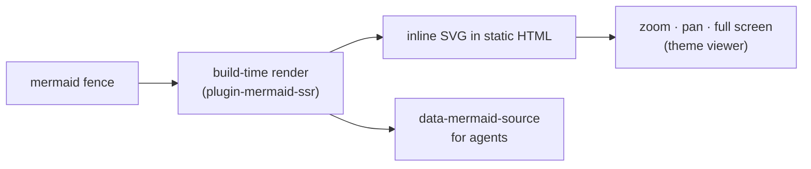

# Diagrams

Write a `mermaid` fence and PokeDocs does the rest. The diagram is rendered to
inline SVG **at build time**, the source is kept on the page for agents, and
readers get a viewer for the diagrams that are too big to read in a column.



## The viewer

Every diagram gets an **Expand** button. Clicking it, or the diagram itself,
opens the diagram in a viewer that covers the window. Try it on the diagram
above.

| Action | Mouse or touch | Keyboard |
|---|---|---|
| Zoom | Scroll, pinch, or double-click | `+` and `-` |
| Pan | Drag | Arrow keys |
| Fit to screen | **Fit** | `0` |
| Actual size | The percentage | `1` |
| Full screen | The full-screen button | `F` |
| Close | The close button | `Esc` |

There is nothing to configure and nothing to swizzle. A few properties worth
knowing:

- **It stays sharp.** The SVG is resized rather than scaled as a bitmap, so
  labels are crisp at every zoom level, up to 800%.
- **It costs nothing elsewhere.** The pan and zoom code is its own chunk,
  fetched only on pages that contain a diagram.
- **It works without JavaScript.** The diagram is static HTML either way; the
  viewer is an enhancement on top of it.
- **Agents are unaffected.** The `pokedocs-mermaid` wrapper and its
  `data-mermaid-source` attribute are unchanged, and so are the `.md` twins.

## Customizing the frame

The frame around a diagram is a normal theme component,
`@theme/PokedocsMermaid`. Swizzle it to change the button or the layout:

```bash
npx docusaurus swizzle pokedocs-theme-components PokedocsMermaid --wrap
```

The viewer's colors come from the Infima variables your
[branding](./branding.md) block compiles, so it follows your brand and both
color modes on its own.

## Turning it off

`mermaid: false` in the preset options turns off build-time rendering and the
viewer together. To keep the rendering and drop the viewer, swizzle
`@theme/PokedocsMermaid` and return a plain `<div {...props} />`.

## Using the packages without the preset

The preset registers the viewer for you. If you wire the packages by hand, add
the theme after the classic theme:

```ts title="docusaurus.config.ts"
import { pokedocsThemeComponents } from '@pokedocs/theme';

export default {
  themes: [pokedocsThemeComponents],
};
```
